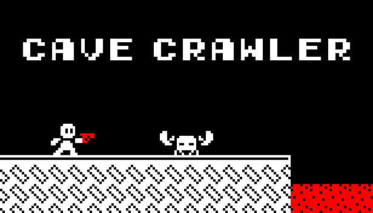
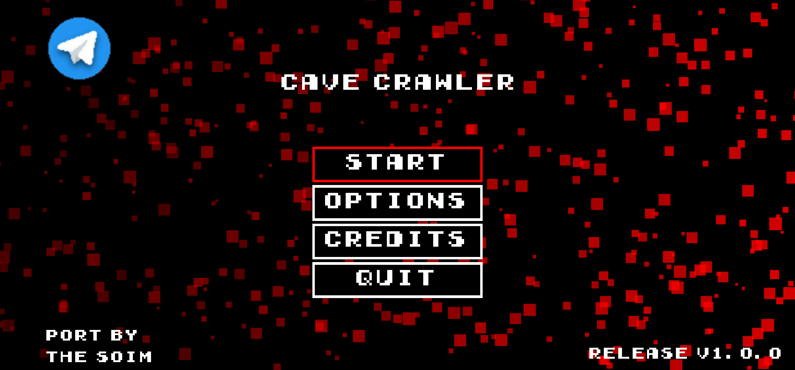
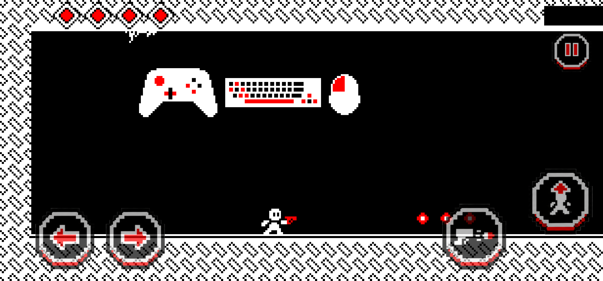
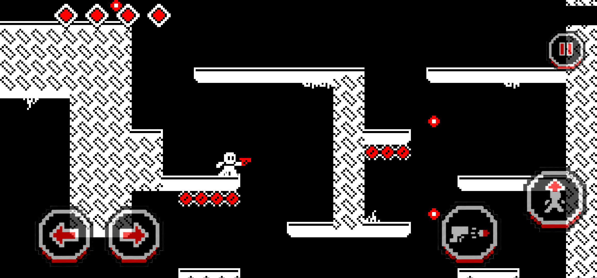

<div align="center">
  

  <h1>Cave Crawler for Android</h1>

  <p>A community Android port of the original Cave Crawler adventure, adapted for touchscreen phones and tablets.</p>

  <p><a href="https://github.com/Thesoim/Cave-Crawler/releases"><strong>Download the latest release</strong></a></p>
</div>

## About the project

Cave Crawler for Android brings the original 2D cave adventure to mobile devices while preserving the game files. The port adds responsive on-screen controls, multi-touch input, touch-enabled menus, immersive full-screen presentation and configurable options for a comfortable mobile experience.

The Android project is prepared from the official Godot 3.5 export template. GitHub Actions can build the Android package automatically.

## In-game screenshots

<div align="center">
  
  <br /><br />
  
  <br /><br />
  
</div>

## Mobile features

The port includes on-screen movement, jump, shoot and pause controls, with optional up and down buttons. Multi-touch supports simultaneous actions, and players can adjust button size, opacity and position.

Menus respond to touch. Display settings offer full-screen scaling or the original 16:9 presentation, alongside vibration, frame-rate and touch-debug options. Gamepad input remains supported, and the app pauses when it loses focus.

## Download

Download the latest published Android build from [GitHub Releases](https://github.com/Thesoim/Cave-Crawler/releases). If no release is available yet, use the source build instructions below or check back later.

## Build from source

The build requires Python 3, JDK 11, an Android SDK and the Godot 3.5.3 Android export template. From the repository root, prepare the Android project with:

```bash
python3 tools/prepare_project.py
```

The preparation script downloads the required template when needed. To use a local template archive, provide it with `--template android_source.zip`.

Build the release APK with Gradle:

```bash
cd build/android-project
./gradlew assembleRelease
```

The APK is generated under `build/outputs/apk/release/`. Alternatively, push a change to GitHub and use the repository’s Actions workflow to build the Android package.

## Repository structure

The `.github/workflows/` directory contains the automated Android build workflow. The `game/` directory holds the original game pack, while `overlay/android_port/` contains the Android port layer and touch-control artwork. Launcher icon assets are stored in `overlay/icons/`, and `tools/` contains the project preparation script and touch-logic tests. The `assets/` directory contains the capsule artwork and gameplay screenshots shown above.

## Project status

The preparation tooling and touch-logic scenarios have been tested by the project author. The Android GDScript layer and Java plugin should be considered unverified until compiled and tested on a device. When reporting an issue, include reproducible steps and relevant build output or device logs.

## Credits and distribution

Cave Crawler was created by **evan12811** using Godot 3.5.1. The game files originate from the PortMaster release, ported by **Fraxinus88**. Android port by **TheSoim**.

Distribution of the game is permitted only while it remains completely free. Please respect the original creator’s terms and do not sell or bundle the game with paid products.

For updates and community information, visit [TheSoim on Telegram](https://t.me/thesoim).
